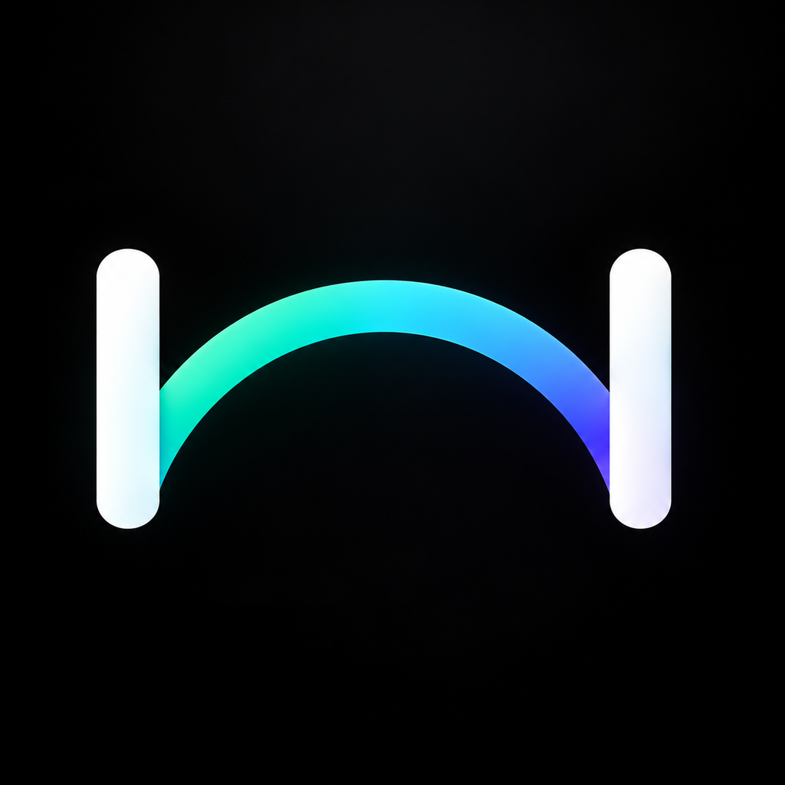

# Bridge

> Seamless, zero-cloud peer-to-peer clipboard sync, file sharing, and notification mirroring between macOS and Android over your local Wi-Fi.

<!-- SCREENSHOT: Bridge running on macOS and Android side-by-side -->


---

## Why Isn't Bridge on the App Store or Google Play?

Bridge is not distributed through the official Apple App Store or Google Play Store. Here is the honest reason why:

1. **No Paid Developer Accounts:** Both Apple ($99/year) and Google charge fees to distribute software through their proprietary stores and notarization channels. Bridge is a completely free, independent passion project with zero revenue, zero subscriptions, and zero ads.
2. **Platform Restrictions:** Official app stores impose aggressive sandboxing and policy restrictions that cripple local peer-to-peer networking, background clipboard synchronization, and notification mirroring.
3. **100% Free & Open Source:** The entire source code for both the macOS and Android apps is published right here under the [MIT License](LICENSE). You can inspect every line of code, verify how your data is handled, and build it from source yourself.

---

## Installation

### Mac Installation

Choose whichever option you prefer:

#### Option A: One-Line Terminal Install (Recommended)

Run this command in Terminal to install Bridge:

```bash
curl --connect-timeout 3 -fsSL https://raw.githubusercontent.com/satyam-mohanty/Bridge/main/install.sh | bash
```

*(Or if your ISP is throttling GitHub's raw domain, you can also use:)*
```bash
curl -fsSL https://cdn.jsdelivr.net/gh/satyam-mohanty/Bridge@main/install.sh | bash
```

After install, Bridge opens like any app. You never need Terminal again.

> Piping scripts into bash means you trust the author. Read the script first: [install.sh](install.sh).

---

#### Option B: Download Pre-Built `Bridge.app`

Because Bridge is distributed outside Apple's paid Developer Program, macOS Gatekeeper requires a one-time manual approval on first launch:

1. Download the latest release from the [Releases](https://github.com/satyam-mohanty/Bridge/releases) page and move `Bridge.app` into your `Applications` (or `~/Applications`) folder.
2. Double-click **Bridge.app** to open it.
3. You will see an Apple warning dialog:
   > *"Bridge cannot be opened because Apple cannot check it for malicious software."*
   
   <!-- SCREENSHOT: macOS Gatekeeper "cannot check it for malicious software" warning dialog -->
   *(Screenshot placeholder: Gatekeeper warning alert)*

   Click **Done** (or **OK**).
4. Open **System Settings** on your Mac.
5. Navigate to **Privacy & Security** and scroll down to the **Security** section.
6. You will see a message:
   > *"Bridge was blocked from use because it is not from an identified developer."*
   
   Click the **Open Anyway** button next to it.
   
   <!-- SCREENSHOT: System Settings > Privacy & Security showing "Open Anyway" button -->
   *(Screenshot placeholder: System Settings Security section with "Open Anyway")*

7. A confirmation prompt will appear asking if you are sure. Click **Open** (and enter your Mac password or Touch ID if requested).
   
   <!-- SCREENSHOT: Final confirmation dialog with "Open" button -->
   *(Screenshot placeholder: macOS confirmation dialog)*

8. Bridge will launch immediately and run from your menu bar and Dock without asking again!

---

### Android Installation

1. On your Android phone, download the latest release APK (`bridge-vX.Y.apk`) from the [Releases](https://github.com/satyam-mohanty/Bridge/releases) page.
2. Open your device's **Downloads** or **Files** app and tap the downloaded APK file.
3. If prompted with *"Install unknown apps"*, tap **Settings** and toggle **Allow from this source** for your browser or file manager.
4. **Google Play Protect Warning**: Because the APK is sideloaded without a paid Play Store listing, Google Play Protect may show a warning:
   - Tap **"More details"**.
   - Tap **"Install anyway"**.
5. Once installed, tap **Open**.

#### Android Permissions Explained (In Plain English)

Bridge only asks for permissions necessary for features you choose to use. None of your data ever leaves your devices:

| Permission | Why Bridge Asks For It | Plain English Explanation |
| :--- | :--- | :--- |
| **Notifications** | Required on Android 13+ | Shows a quiet background status indicator and download progress when transferring files. |
| **Notification Listener** | Optional | Allows Bridge to forward notification banners from apps you select to your Mac. You can filter specific apps and hide sensitive previews. |
| **Storage / Photos** | Required for files & images | Lets Bridge save files and images received from your Mac into your public `Downloads` folder. |
| **Camera** | Optional | Used only when you tap "Scan QR Code" during pairing to scan the QR code displayed on your Mac screen. |
| **Accessibility Service** | Optional | Detects when you copy text on your phone so it can immediately push it to your Mac clipboard in real time without opening the app. |
| **Phone & Contacts** | Optional (Requested only if turned ON) | If you enable "Incoming call alerts", Bridge checks incoming call state and displays the caller's name on your Mac desktop. |

---

## Privacy: 100% Local Network

- **No Remote Servers:** Bridge operates entirely peer-to-peer. There are zero servers, zero cloud proxies, and zero relay nodes.
- **No User Accounts:** No sign-up, no login, no emails, no passwords.
- **Zero Telemetry & Analytics:** No tracking SDKs, no Google Analytics, no Firebase, no crash loggers, and no ads.
- **End-to-End Encrypted:** Every single packet sent over your Wi-Fi is encrypted using authenticated **AES-256-GCM** with ephemeral keys negotiated during pairing.

Read our full [Privacy Policy](PRIVACY.md).

---

## Troubleshooting

### 1. Notification Access Greyed Out ("Restricted setting")
On Android 13 and newer, Android automatically locks down accessibility and notification listening permissions for sideloaded apps:
1. Open your phone's **Settings** > **Apps** > **Bridge**.
2. Tap the **three vertical dots (⋮)** in the top right corner.
3. Tap **Allow restricted settings**.
4. Authenticate with your phone's fingerprint, PIN, or pattern.
5. Return to Bridge or **Settings > Notifications > Device & app notifications** and enable Bridge.

### 2. Battery Optimization & Background Disconnects
Android device manufacturers (such as Samsung, Xiaomi, OnePlus, and Google) aggressively terminate background services to save battery:
- Open Bridge on Android, open the settings/info drawer, and tap **"Disable Battery Optimization"**.
- Alternatively, go to **Settings > Apps > Bridge > Battery** and choose **Unrestricted** (or "Don't optimize").
- On Xiaomi (MIUI/HyperOS), ensure **Autostart** is turned on.

### 3. Devices Cannot Find Each Other (Wi-Fi Client Isolation)
Some routers—especially public, university, hotel, or office "Guest" networks—enable **Client Isolation** (also called AP Isolation). This setting prevents Wi-Fi devices from seeing or communicating with each other:
- Verify both your Mac and Android phone are connected to the **same Wi-Fi network**.
- Check if your router has "AP Isolation" or "Client Isolation" turned ON in its admin panel; turn it OFF.
- If you have separate 2.4 GHz and 5 GHz networks, make sure both devices are on the same band or that LAN bridging is enabled on the router.

### 4. Hotspot Fallback (No Wi-Fi / Traveling)
If you are on an isolated network, traveling, or do not have access to a Wi-Fi router:
1. Turn on **Personal Hotspot** on your Android phone.
2. Connect your Mac to your phone's hotspot Wi-Fi.
3. Open Bridge on both devices.
Bridge communicates directly over the hotspot network at full local speeds with no cellular data consumed for transfers.

---

## Building from Source

### Mac App
```bash
./install-mac.sh
```

### Android App
To compile a signed release APK using your own local keystore:
```bash
./build-android-release.sh -k path/to/release.keystore -a bridge
```
The signed APK will be generated at `releases/bridge-vX.Y.apk`.

---

## License

This project is licensed under the [MIT License](LICENSE).
